# MGR3DO System manual

**[Português](MANUAL.md)** · [Back to the README](README.en.md)

This manual shows how to build the ISO with the Manager and, screen by screen, how to use MGR3DO System on the 3DO.

## 1. Build the ISO on the PC (Manager)

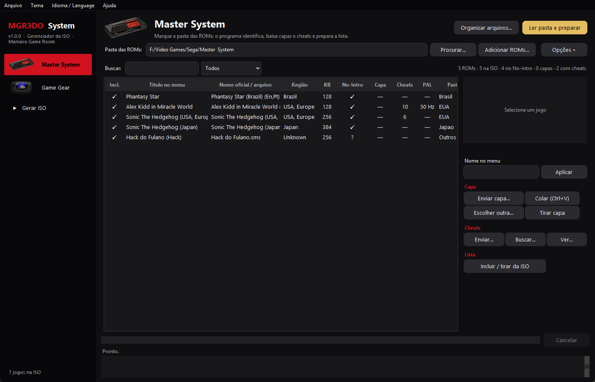

1. Download **`MGR3Do-System-Gerenciador.exe`** from the **[Releases](../../releases)** page and open it. It is a single file, no install. Keep it in a folder of yours (Documents, for example): the automatic update replaces the `.exe` in that folder.
2. On the **Master System** page, click **Browse…**, choose the folder with your ROMs and click **Read folder and prepare**. The program:
   - identifies each ROM by its content (CRC32 against the No-Intro database), also inside `.zip` files;
   - keeps one good copy of each game (preferred region, verified dump, final version);
   - downloads the cover and the cheats of each game.
3. Do the same on the **Game Gear** page.
4. Check the list. The filters show included, excluded, without cover, without cheats and outside No-Intro. For each game you can:
   - **Upload cover…** (file) or **Paste (Ctrl+V)** an image;
   - **Choose another…** cover from libretro, with the original image and **how the 3DO shows it**;
   - send your own `.cht`, search or view the cheats;
   - change the **Menu title**;
   - click the **PAL** column (Master System only) to switch 50 Hz on or off;
   - **Include / leave out** of the ISO.
5. On the **Build ISO** page, check the summary and click **Build ISO…**. The program never overwrites an existing ISO.
6. **File > Save project** keeps everything in a `.mgr3do.json`, which points to your ROMs without copying them.

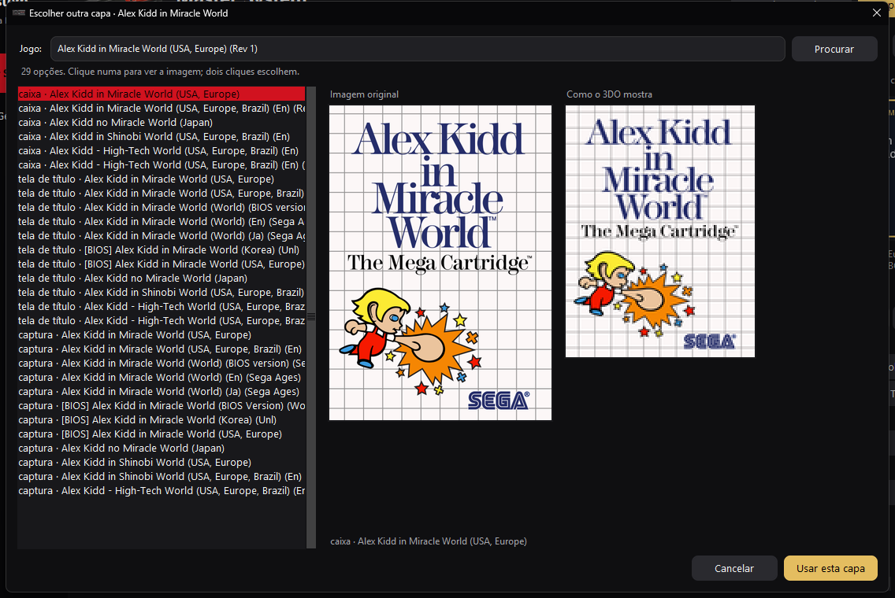

### Manager options

- **One copy per game** from the preferred region (USA, Europe, Brazil or Japan first) or one per region.
- **Outside No-Intro** (translations, hacks): included and marked, with “(Trad. Bra)” or “(Hack)” in the title. Bad dumps and BIOS stay out.
- **Title in the menu:** name only, name and region, or the full official name.
- **Menu folders:** automatic (region and letter from 150 games on), by region, by letter, by region and letter, or no folders.

### Organize your folder (optional)

**Organise files…** renames the recognized ROMs to the official No-Intro name and, if you want, splits them into folders (by region, by letter or both). Before applying, it shows the “from → to” list. Copies left out of the ISO go to `_duplicados`. Nothing is deleted or overwritten, and **Undo last** puts everything back.

### Updates

When it opens, the program checks the Releases. If there is a new version, a notice shows up in the sidebar; clicking it shows what is new and the **Download and update** button. The downloaded file is verified (SHA-256) before the swap, and the previous `.exe` is kept next to it as `.anterior`. To turn this off: **Help > Check when the program starts**. To check right away: **Help > Check for updates…**.

The program data (settings, No-Intro database, downloaded covers and cheats) lives in `%LOCALAPPDATA%\MGR3Do-System`. **Help > Refresh databases** downloads everything again.

## 2. Take it to the 3DO

1. Copy **`MGR3DoSystem.iso`** to your ODE's pen drive (or card), like any other 3DO ISO.
2. For **save states**, leave free space on the pen drive. The state goes to the `saves` folder if it exists, or to the root.
3. In the ODE menu, pick the ISO. The loading screen and a short opening video show up; **any button skips the video**.

## 3. The game list

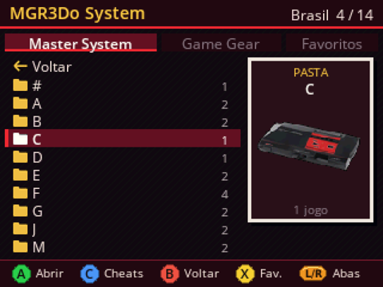

| Button | In the list |
|---|---|
| Up / down | choose the game or folder (hold to repeat) |
| Left / right | jump to the next or previous letter |
| **A** | opens the folder or plays |
| **P** (Start) | plays **continuing from the save state**, when the game has one |
| **B** | inside a folder, goes up one level; at the top, opens the **Options** |
| **C** | opens the game's **cheats** |
| **X** | marks or unmarks the **favourite** (star) |
| **L / R** | switch tabs: Master System, Game Gear and Favourites |

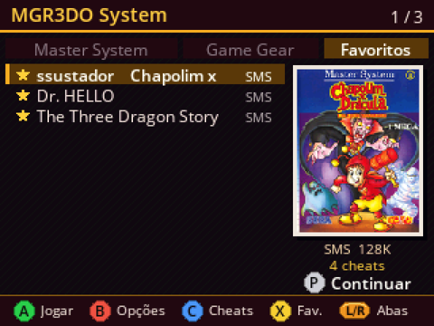

Under the cover you see the console and the ROM size (for example, `SMS 128K`), how many cheats the game has and, if there is a save state on the pen drive, **P Continue**. A long title scrolls on the selected line. (The screenshots show the menu in Portuguese; Options > Language switches it to English.)

**Favourites:** the tab joins the marked games of both consoles. The list lives in the 3DO's memory and stays there after you turn it off (up to 256 games).

## 4. Playing

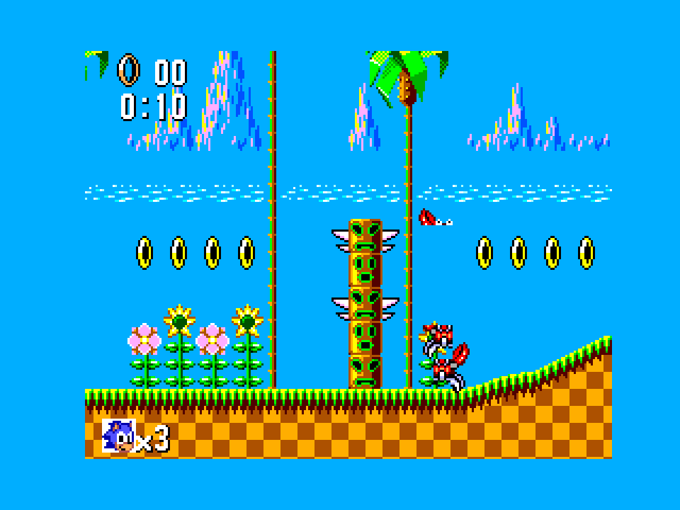

| 3DO button | In the game (default) |
|---|---|
| D-pad | the console's D-pad |
| **A** | button 1 |
| **B** | button 2 |
| **C** | nothing |
| **P** (Start) | Pause / Start |
| **X** | opens the **game menu** |
| **L** | Game Gear zoom: original (160×144) or 1.25x (200×180) |

A, B and C can be changed in **Options > Controls**. The second controller plays as player 2.

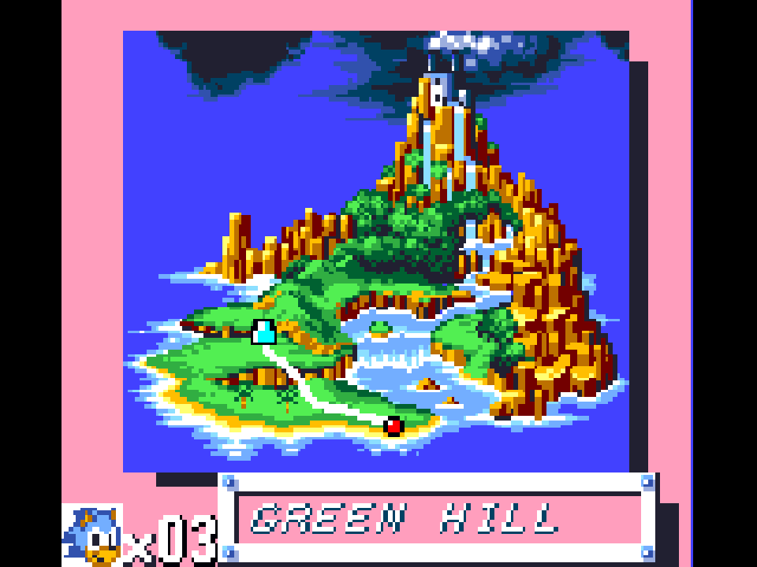

- **PAL games** (50 Hz, most European ones) run at the right speed and with the right music on a 60 Hz TV.
- **Battery saves:** games that save on the cartridge (RPGs, for example) keep the save in the 3DO's memory.
- Big ROMs (over 512 KB) take a few seconds to load.

## 5. Game menu (X button)

| Item | What it does |
|---|---|
| **Resume the game** | back to the game |
| **Cheats** | switches the game's cheats on and off |
| **Save state** | saves the exact point of the game (one state per game) |
| **Load state** | goes back to the saved point |
| **Restart the game** | starts over |
| **Back to the main menu** | back to the list |

After saving, the screen tells you where the state went:

- **“State saved on the pen drive”**: kept for next time, and the list shows **P Continue** on the game.
- **“State saved in memory only”**: the ODE did not take the file (another ODE, a burned CD, a full pen drive). You can load it while the game is open; when you go back to the menu, the state is lost.

Some big games leave no free memory for the state; in that case the screen says so and the game goes on normally.

### Cheats

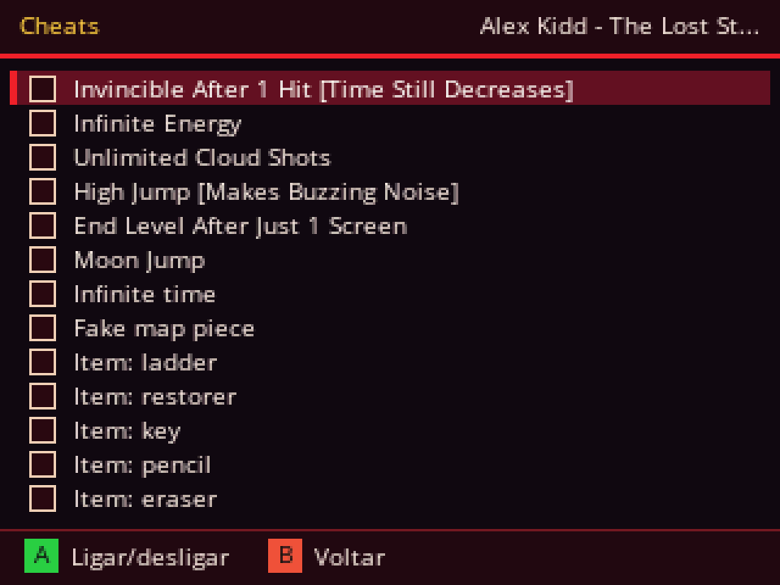

**A** switches on or off, **B** goes back. What you switched on is kept for next time. There are memory cheats (applied every frame) and Game Genie cheats (change the game when it loads). A long name scrolls on the selected line.

## 6. Options

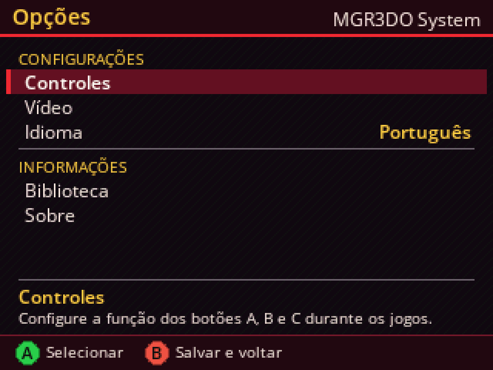

In the list, **B** opens the Options. **A** enters the chosen page; **B** saves and goes back.

| Page | What it has |
|---|---|
| **Controls** | what A, B and C do in the game: Button 1, Button 2, Pause / Start or Nothing. P, X and L have a fixed function |
| **Video** | **Screen size** (margin for TVs that crop the border), **Game Gear zoom** and **Smooth zoom** (the 3DO's filter on the enlarged Game Gear) |
| **Language** | Português or English |
| **Library** | games per console, cheats, favourites, covers and the date the ISO was built |
| **About** | version and credits |

| | |
|---|---|
| 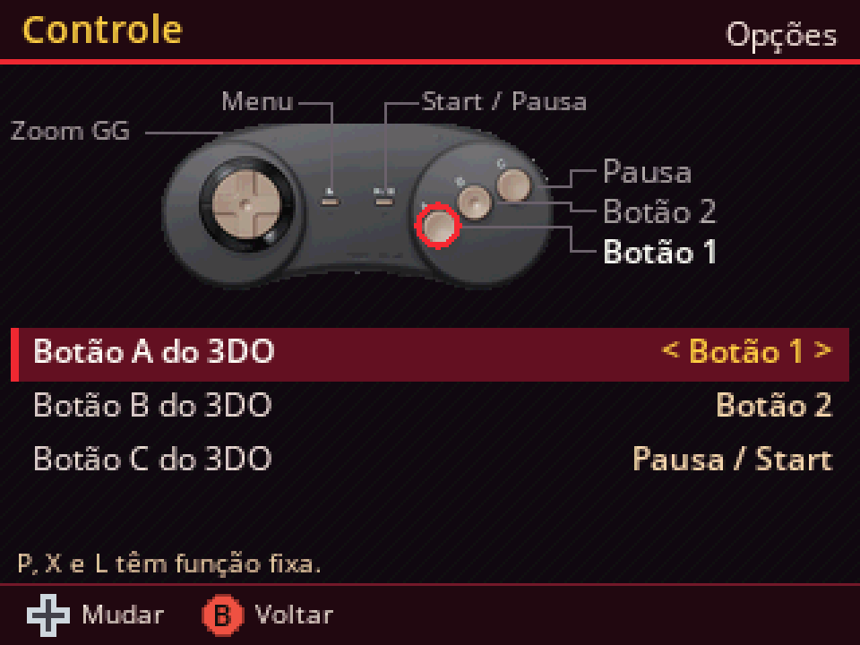 | 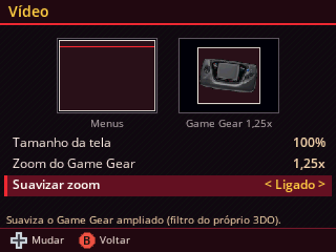 |
| 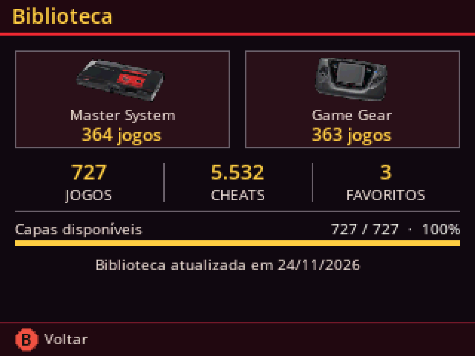 | 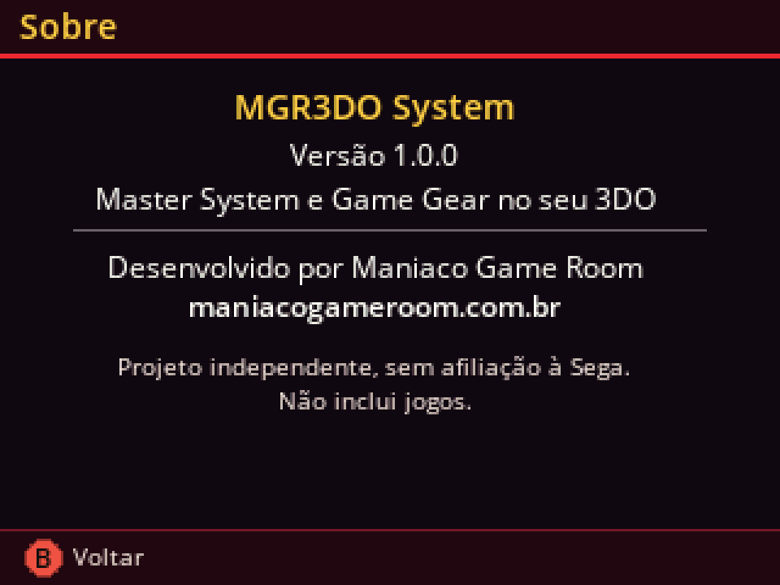 |

## 7. Save states on other ODEs and on CD

| Where it runs | Save state |
|---|---|
| SataTo3DO with the **ManiacoODE** firmware | saved on the pen drive; **P Continue** in the list. Tested |
| SataTo3DO with the **original** firmware | should work (the file commands are the ODE's own protocol). **Not tested** |
| **Another ODE** or a **burned CD** | in memory only, while the game is open |

Favourites, settings and battery saves live in the 3DO's own memory and work in every case.

## 8. Questions and problems

- **The game screen went black.** Some games do not work in the emulator. Go back with **X** and pick another one.
- **The menu crops the borders on the TV.** Lower the **Screen size** in Options > Video.
- **P Continue does not show up.** The state was saved in memory only, or it was written by a version older than 1.0.0: save again.
- **There is no FM.** The FM sound of the Japanese Master System is not emulated; only the PSG.
- **The Manager cannot find the cover or cheats of a game.** Use **Choose another…** or send your own. The approximate search can be wrong: check it.

ROMs, covers and cheats do not come with the project.

## Thanks

MGR3DO System was born from a bold idea: creating emulators for the 3DO, and more projects are on the way. Thanks to [MasterDO](https://github.com/stanton0arch/MasterDO) for being such a wonderful project: thanks to it, ours was able to evolve and reach such an amazing result!

---

A **[Maniaco Game Room](https://www.maniacogameroom.com.br/)** project.
