# Manual do MGR3DO System

**[English](MANUAL.en.md)** · [Voltar ao README](README.md)

Este manual mostra como montar a ISO com o Gerenciador e, tela por tela, como usar o MGR3DO System no 3DO.

## 1. Montar a ISO no PC (Gerenciador)

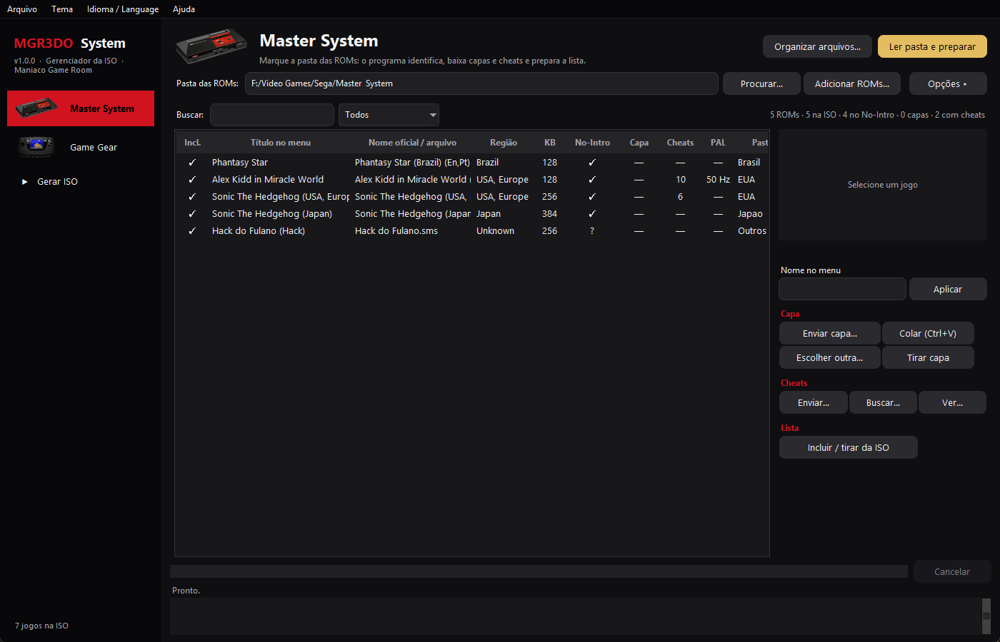

1. Baixe o **`MGR3Do-System-Gerenciador.exe`** na página de **[Releases](../../releases)** e abra. É um arquivo só, sem instalar. Guarde-o numa pasta sua (por exemplo, Documentos): a atualização automática troca o `.exe` nessa pasta.
2. Na página **Master System**, clique em **Procurar…**, escolha a pasta das suas ROMs e clique em **Ler pasta e preparar**. O programa:
   - identifica cada ROM pelo conteúdo (CRC32 contra o banco No-Intro), inclusive dentro de `.zip`;
   - fica com uma boa cópia de cada jogo (a da região preferida, dump verificado, versão final);
   - baixa a capa e os cheats de cada jogo.
3. Faça o mesmo na página **Game Gear**.
4. Confira a lista. Os filtros mostram os incluídos, os excluídos, os sem capa, os sem cheats e os fora do No-Intro. Em cada jogo você pode:
   - **Enviar capa…** (arquivo) ou **Colar (Ctrl+V)** uma imagem;
   - **Escolher outra…** capa do libretro, com a imagem original e **como o 3DO mostra**;
   - enviar o seu `.cht`, buscar ou ver os cheats;
   - mudar o **nome no menu**;
   - clicar na coluna **PAL** (só Master System) para ligar ou desligar os 50 Hz;
   - **Incluir / tirar da ISO**.
5. Na página **Gerar ISO**, confira o resumo e clique em **Gerar ISO…**. O programa nunca sobrescreve uma ISO que já existe.
6. **Arquivo > Salvar projeto** guarda tudo num `.mgr3do.json`, que aponta para as suas ROMs sem copiá-las.

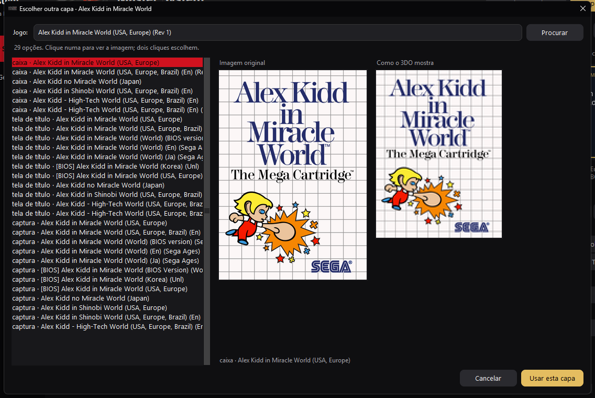

### Opções do Gerenciador

- **Uma cópia por jogo** da região preferida (EUA, Europa, Brasil ou Japão primeiro) ou uma por região.
- **Fora do No-Intro** (traduções, hacks): entram marcados, com “(Trad. Bra)” ou “(Hack)” no título. Dumps ruins e BIOS ficam fora.
- **Título no menu:** só o nome, nome e região, ou o nome oficial completo.
- **Pastas do menu:** automático (região e letra a partir de 150 jogos), por região, por letra, por região e letra, ou sem pastas.

### Organizar a sua pasta (opcional)

**Organizar arquivos…** renomeia as ROMs reconhecidas pelo nome oficial do No-Intro e, se você quiser, separa em pastas (por região, por letra ou os dois). Antes de aplicar, mostra a lista “de → para”. Cópias que ficam fora da ISO vão para `_duplicados`. Nada é apagado nem sobrescrito, e **Desfazer última** devolve tudo ao lugar.

### Atualizações

Ao abrir, o programa consulta as Releases. Se houver versão nova, aparece um aviso na barra lateral; o clique mostra as novidades e o botão **Baixar e atualizar**. O arquivo baixado é conferido (SHA-256) antes da troca, e o `.exe` anterior fica guardado ao lado como `.anterior`. Para desligar: **Ajuda > Verificar ao abrir o programa**. Para consultar na hora: **Ajuda > Verificar atualizações…**.

Os dados do programa (configuração, banco No-Intro, capas e cheats baixados) ficam em `%LOCALAPPDATA%\MGR3Do-System`. **Ajuda > Atualizar bases** baixa tudo de novo.

## 2. Levar para o 3DO

1. Copie a **`MGR3DoSystem.iso`** para o pen drive (ou cartão) da sua ODE, como qualquer outra ISO do 3DO.
2. Para o **estado salvo**, deixe espaço livre no pen drive. O estado vai para a pasta `saves`, se ela existir, ou para a raiz.
3. No menu da ODE, escolha a ISO. Aparecem a tela de carregamento e um vídeo curto de abertura; **qualquer botão pula o vídeo**.

## 3. A lista de jogos

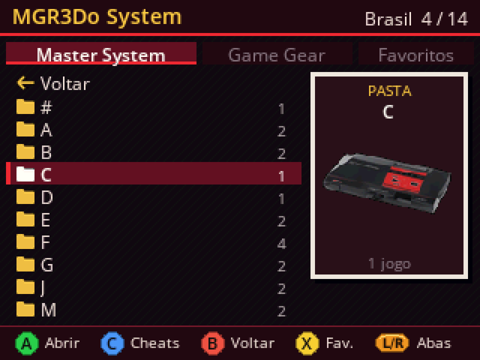

| Botão | Na lista |
|---|---|
| Cima / baixo | escolhem o jogo ou a pasta (segurando, repete) |
| Esquerda / direita | pulam para a letra seguinte ou anterior |
| **A** | abre a pasta ou joga |
| **P** (Start) | joga **continuando do estado salvo**, quando o jogo tem um |
| **B** | dentro de pasta, volta um nível; no topo, abre as **Opções** |
| **C** | abre os **cheats** do jogo |
| **X** | marca ou desmarca o **favorito** (estrela) |
| **L / R** | trocam de aba: Master System, Game Gear e Favoritos |

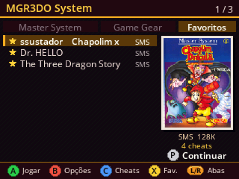

Embaixo da capa aparecem o console e o tamanho da ROM (por exemplo, `SMS 128K`), quantos cheats o jogo tem e, se houver estado salvo no pen drive, **P Continuar**. Título longo rola na linha selecionada.

**Favoritos:** a aba junta os jogos marcados dos dois consoles. A lista fica na memória do 3DO e continua ali depois de desligar (até 256 jogos).

## 4. Jogando

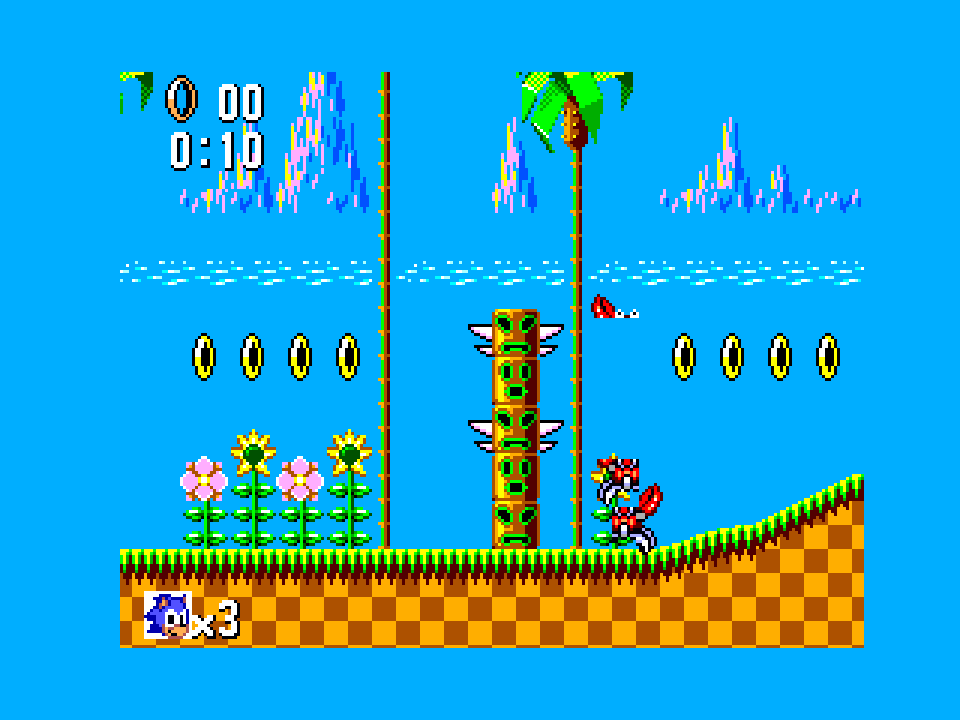

| Botão do 3DO | No jogo (padrão) |
|---|---|
| Direcional | direcional do console |
| **A** | botão 1 |
| **B** | botão 2 |
| **C** | nada |
| **P** (Start) | Pausa / Start |
| **X** | abre o **menu do jogo** |
| **L** | zoom do Game Gear: original (160×144) ou 1,25x (200×180) |

A, B e C podem ser trocados em **Opções > Controles**. O segundo controle joga como jogador 2.

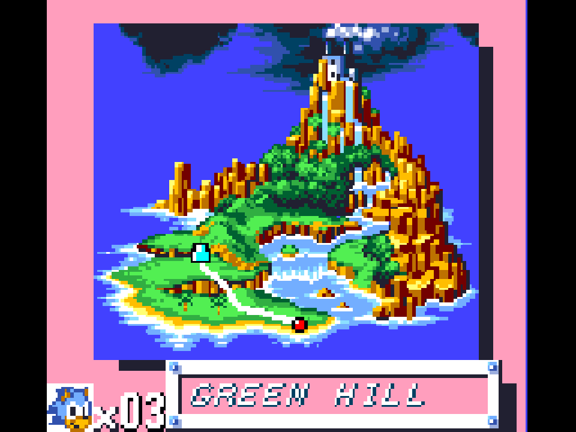

- **Jogos PAL** (50 Hz, a maioria dos europeus) rodam com a velocidade e a música corretas numa TV de 60 Hz.
- **Save de bateria:** os jogos que salvam no cartucho (RPGs, por exemplo) gravam o save na memória do 3DO.
- ROMs grandes (acima de 512 KB) levam alguns segundos para carregar.

## 5. Menu do jogo (botão X)

| Item | O que faz |
|---|---|
| **Continuar o jogo** | volta ao jogo |
| **Cheats** | liga e desliga os cheats do jogo |
| **Salvar estado** | grava o ponto exato do jogo (um estado por jogo) |
| **Carregar estado** | volta ao ponto gravado |
| **Reiniciar o jogo** | começa de novo |
| **Voltar ao menu inicial** | volta à lista |

Depois de salvar, a tela diz onde o estado ficou:

- **“Estado salvo no pen drive”**: fica para a próxima vez, e a lista mostra **P Continuar** no jogo.
- **“Estado salvo só na memória”**: a ODE não aceitou o arquivo (outra ODE, CD gravado, pen drive sem espaço). Dá para carregar enquanto o jogo está aberto; ao voltar ao menu, o estado se perde.

Alguns jogos grandes não deixam memória livre para o estado; nesse caso a tela avisa e o jogo segue normalmente.

### Cheats

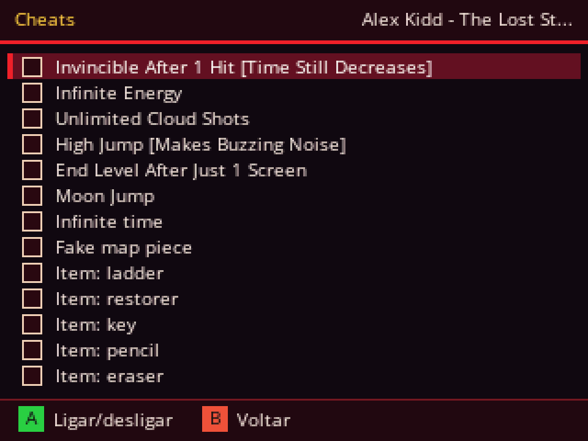

**A** liga ou desliga, **B** volta. O que você ligou fica guardado para a próxima vez. Há cheats de memória (aplicados a cada quadro) e Game Genie (alteram o jogo ao carregar). Nome comprido rola na linha selecionada.

## 6. Opções

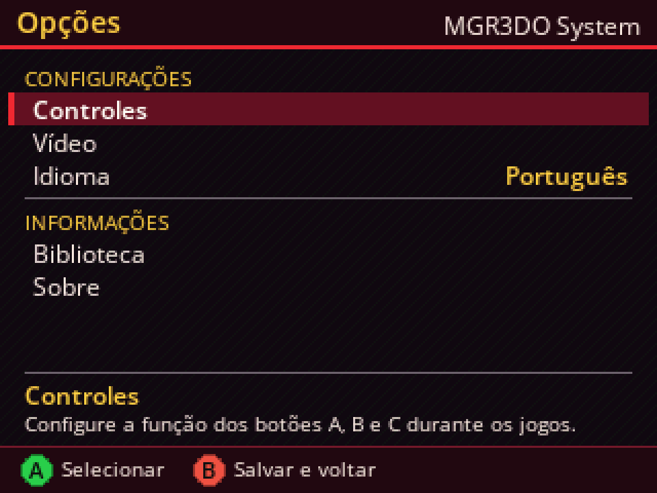

Na lista, **B** abre as Opções. **A** entra na tela escolhida; **B** grava e volta.

| Tela | O que tem |
|---|---|
| **Controles** | a função de A, B e C no jogo: Botão 1, Botão 2, Pausa / Start ou Nada. P, X e L têm função fixa |
| **Vídeo** | **Tamanho da tela** (margem para TVs que cortam a borda), **Zoom do Game Gear** e **Suavizar zoom** (filtro do 3DO no Game Gear ampliado) |
| **Idioma** | Português ou English |
| **Biblioteca** | jogos por console, cheats, favoritos, capas e a data da montagem da ISO |
| **Sobre** | versão e créditos |

| | |
|---|---|
| 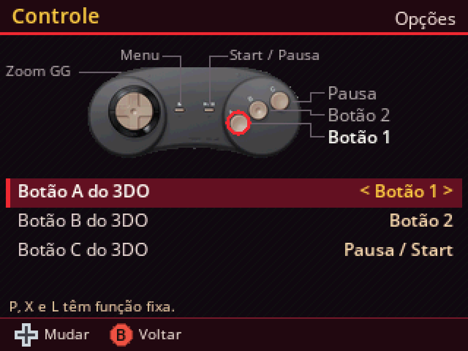 | 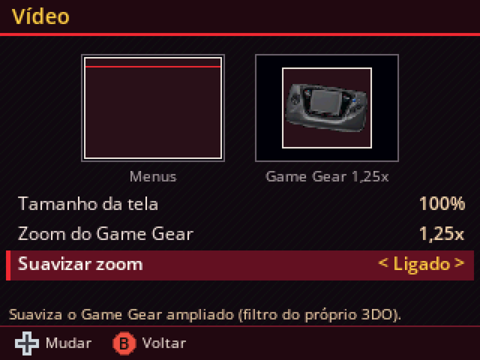 |
| 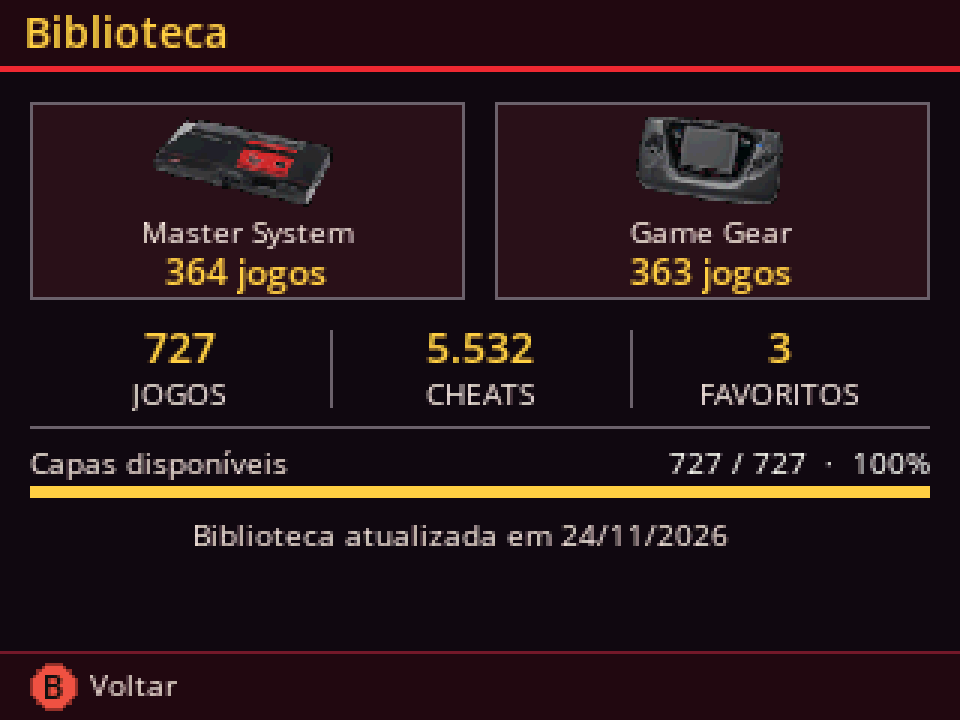 | 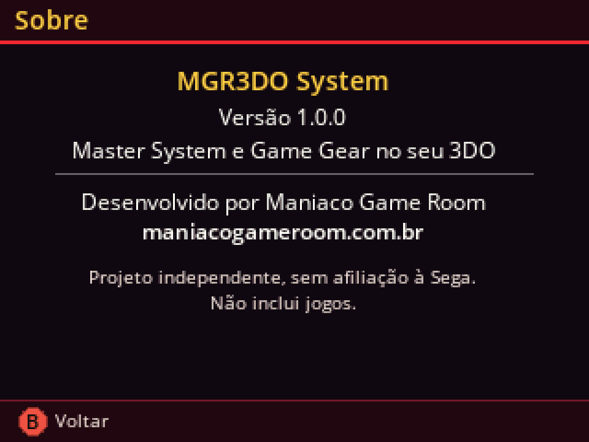 |

## 7. Estado salvo em outras ODEs e em CD

| Onde roda | Estado salvo |
|---|---|
| SataTo3DO com o firmware **ManiacoODE** | grava no pen drive; **P Continuar** na lista. Testado |
| SataTo3DO com o firmware **original** | deve funcionar (os comandos de arquivo são do protocolo da própria ODE). **Não testado** |
| **Outra ODE** ou **CD gravado** | só na memória, enquanto o jogo está aberto |

Favoritos, configurações e saves de bateria ficam na memória do próprio 3DO e funcionam em qualquer caso.

## 8. Perguntas e problemas

- **A tela do jogo ficou preta.** Alguns jogos não funcionam no emulador. Volte com **X** e escolha outro.
- **O menu corta as bordas na TV.** Reduza o **Tamanho da tela** em Opções > Vídeo.
- **Não aparece P Continuar.** O estado foi salvo só na memória, ou foi gravado por uma versão anterior à 1.0.0: salve de novo.
- **Não há FM.** O som FM do Master System japonês não é emulado; só o PSG.
- **O Gerenciador não acha capa ou cheats de um jogo.** Use **Escolher outra…** ou envie os seus. A busca aproximada pode errar: confira.

As ROMs, capas e cheats não acompanham o projeto.

## Agradecimento

O MGR3DO System nasceu de uma ideia audaciosa: criar emuladores para o 3DO, e outros projetos estão por vir. Obrigado ao [MasterDO](https://github.com/stanton0arch/MasterDO) por ser um projeto maravilhoso: graças a ele, o nosso pôde evoluir e ter um resultado tão incrível!

---

Um projeto **[Maniaco Game Room](https://www.maniacogameroom.com.br/)**.
