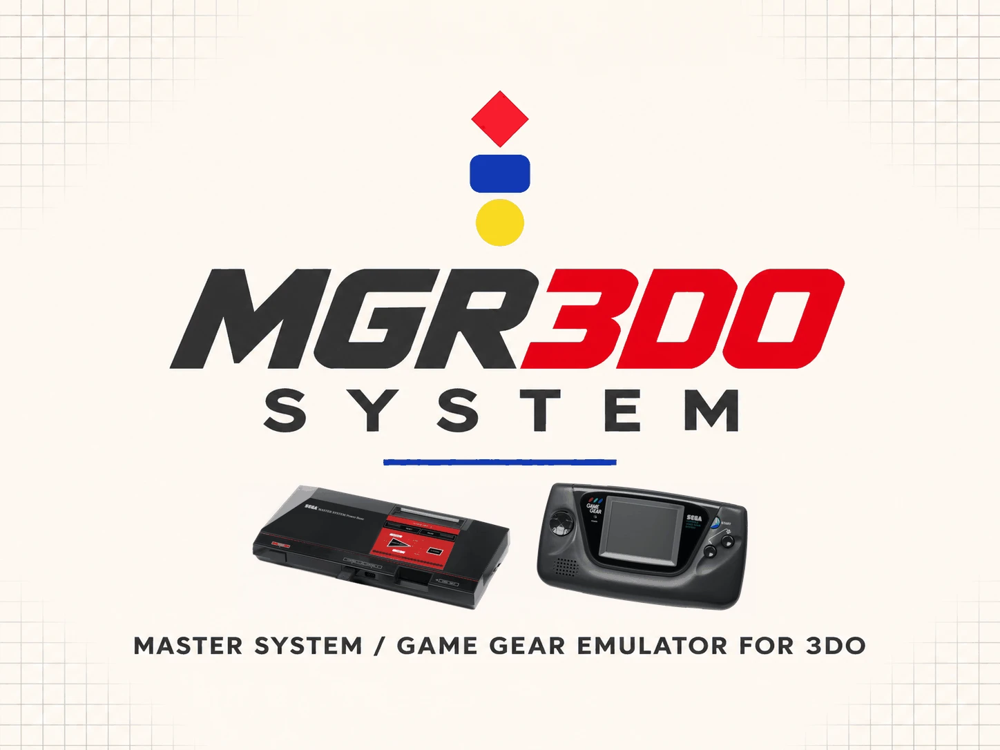
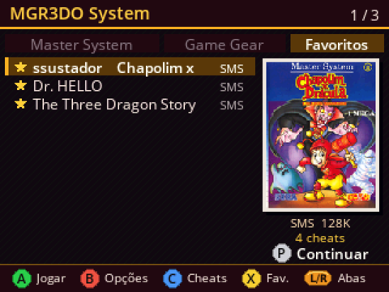
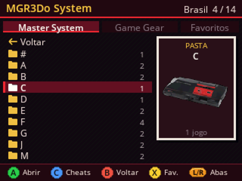
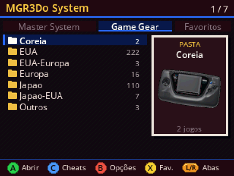
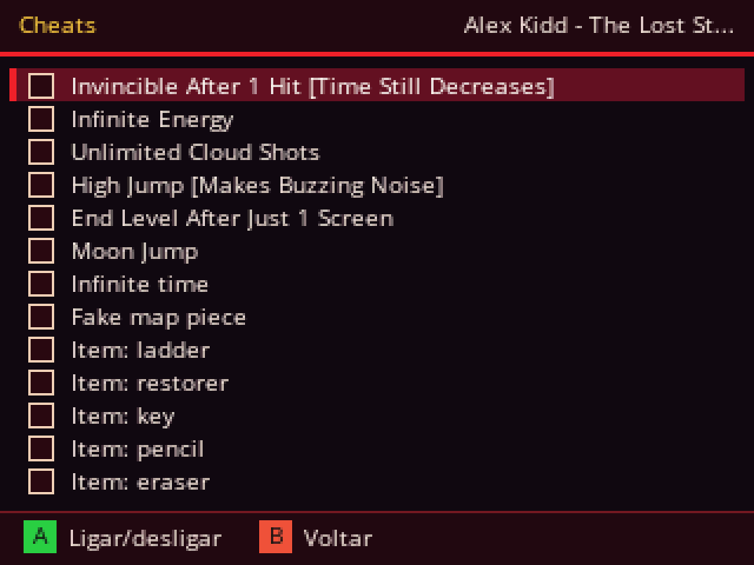
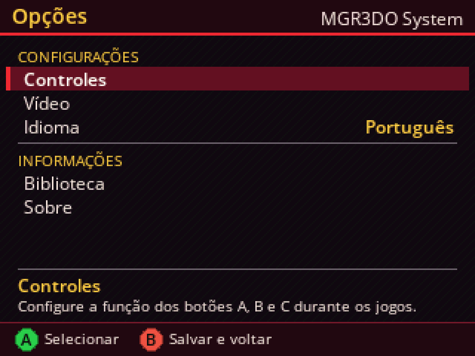
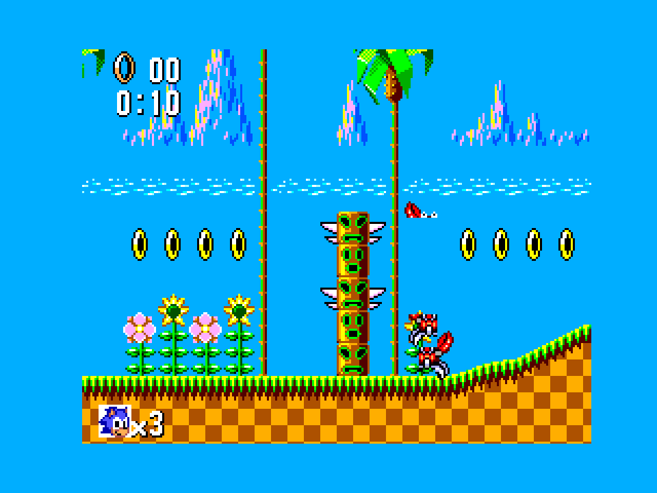
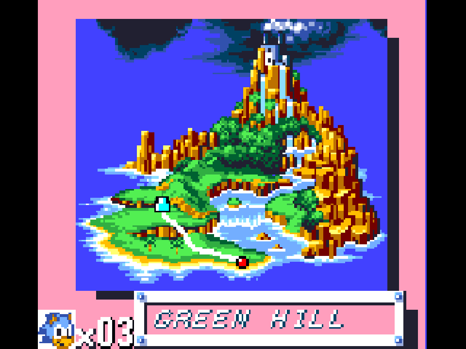
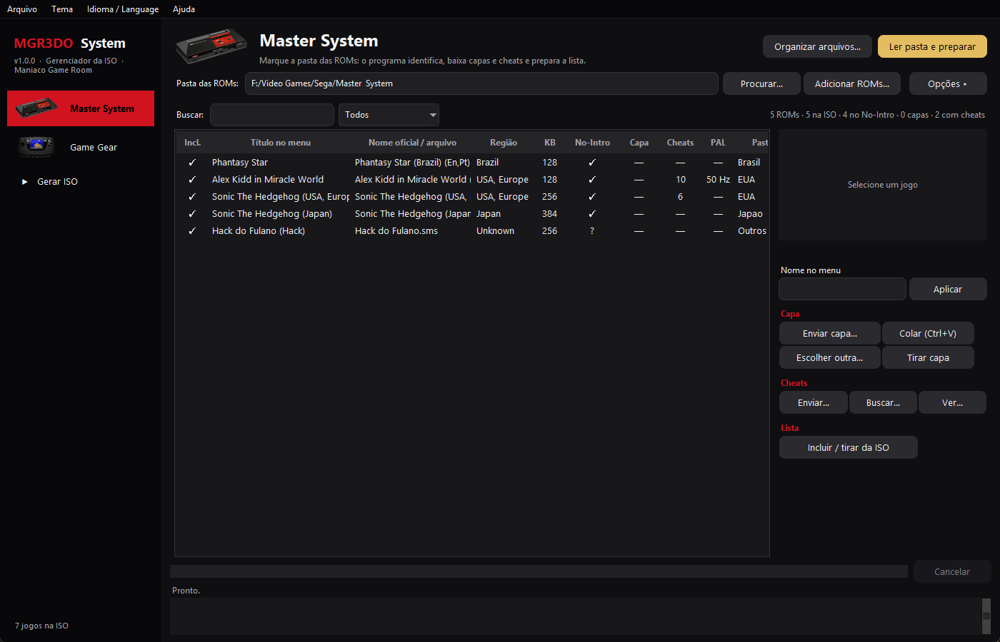
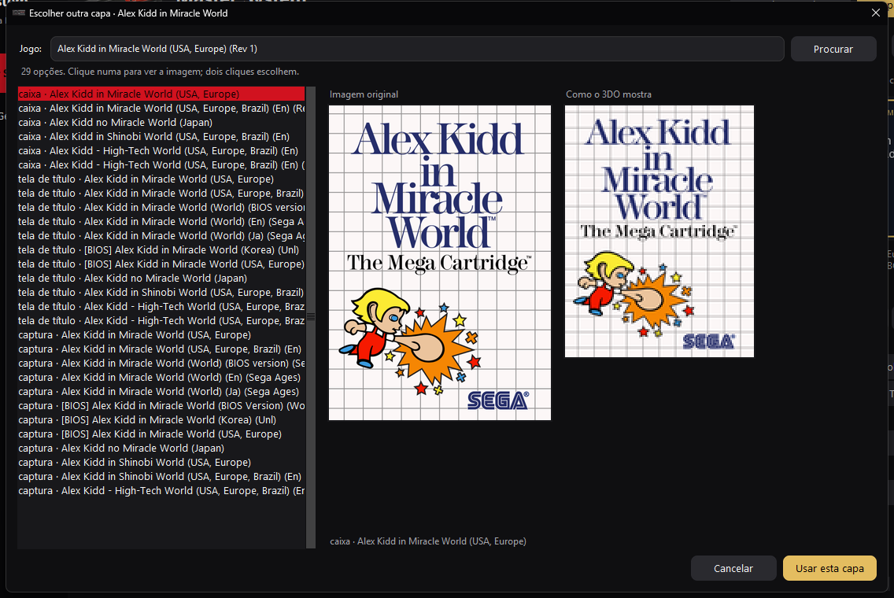

# MGR3DO System

**[Português](README.md)**

**Master System and Game Gear emulator for the 3DO, with a menu in Portuguese or English, folders, box art, ready-made cheats and save states on the pen drive, plus a Windows app that builds the ISO from your own ROMs.**

A **[Maniaco Game Room](https://www.maniacogameroom.com.br/)** project.

> **Tested on real hardware:** 3DO with the **SataTo3DO** ODE (ManiacoODE firmware), ISO built by Manager 1.0.0. See [What was tested](#what-was-tested).

## What is new in 1.0.0

- **New menu:** folders with icons, one color per tab (Master System red, Game Gear blue, Favorites amber), cover with the console, the ROM size and how many **cheats** the game has.
- **P Continue:** a game with a save state on the pen drive shows **P Continue** under the cover; P opens the game right at the saved point.
- **Options in pages:** Controls (photo of the 3DO pad), Video, Language, Library (games, cheats, covers and favorites) and About.
- **Smooth zoom:** the enlarged Game Gear picture (1.25x) can use the 3DO's own filter.
- **Manager 1.0.0:** a single `.exe` that **updates itself** from the Releases; PAL column in the table; choose another cover with a preview of how the 3DO shows it.

## What MGR3DO System brings

| | |
|---|---|
|  |  |
|  |  |

- **Three tabs:** Master System, Game Gear and **Favorites**, in alphabetical order, with the **cover** beside the list. Big libraries are split into **folders** (by region and letter, for example).
- **Favorites:** the **X** button marks the game with a star; the Favorites tab joins both consoles. Kept in the 3DO's memory.
- **Jump by letter:** left and right jump to the next or previous letter.
- **Ready-made cheats** (RAM and Game Genie) for most games, turned on and off in the menu; the choice is kept.
- **Save states on the pen drive**, one per game, from the in-game menu (X button), and **P Continue** in the list.
- **PAL games at 50 Hz** with the right speed and music on a 60 Hz TV.
- **Big ROMs** (up to 4 MB) and **battery saves** for the games that have them (RPGs) in the 3DO's memory.
- **Configurable buttons** (A, B and C), second controller, screen size for TVs that crop the border, and menus in **Portuguese or English**.

| | |
|---|---|
|  |  |

## The app: MGR3DO System · Manager

The emulator comes already built inside the app. With your ROMs on the PC, it:

1. **identifies each ROM by its content** (CRC32 against the No-Intro database), also reads `.zip` files and picks one good copy of each game;
2. **downloads the cover and the cheats** by the official name;
3. lets you check everything: send your own cover, **choose another** with a preview of how the 3DO shows it, send your own `.cht`, edit the title, mark PAL and include or remove games;
4. **builds the MGR3DO System ISO**, ready for the ODE's pen drive.

It also **organizes your folder** (renames by the official name and splits into folders, with **Undo**) and works in **Portuguese or English**. Your ROMs are never changed.

## How to use

1. Download **`MGR3Do-System-Gerenciador.exe`** from the **[Releases](../../releases)** page (a single file, no install).
2. Open the program, choose the folder with your **Master System** ROMs and click **Read folder and prepare**. Do the same on the **Game Gear** page.
3. Check the list and, on **Build ISO**, click **Build ISO…**.
4. Copy `MGR3DoSystem.iso` to the ODE's pen drive, pick the ISO in the ODE menu and play.

The app **updates itself**: when it opens, it tells you if there is a new version in the Releases and replaces the `.exe` with one click (Help > Check for updates…).

Full step-by-step guide, with the controller buttons: **[Manual](MANUAL.en.md)**.

## Requirements

- **3DO** with an **ODE** that loads ISOs from a pen drive or card (tested: SataTo3DO with the ManiacoODE firmware).
- Windows 10 or 11 for the Manager; internet the first time (covers, cheats and the No-Intro database are kept on the PC).
- Your own Master System and Game Gear ROMs (`.sms`, `.gg`, loose or in `.zip`). **The project includes no games.**

## Save states: which ODE works

The state is written to a file on the pen drive (`MGR3-<game>.cap`, in the `saves` folder if there is one). To do that, the emulator talks to the ODE through file commands.

| Where it runs | Save state |
|---|---|
| **SataTo3DO with the ManiacoODE firmware** | Works: saved on the pen drive, kept for next time, and **P Continue** shows up. Tested. |
| **SataTo3DO with the original firmware** | Should work: the file commands are the ODE's own protocol. **Not tested.** |
| **Another ODE** or a **burned CD** | The game runs normally, but the state stays **in memory only**: you can load it while the game is open, and it is lost when you go back to the menu or turn the console off. The screen says “State saved in memory only”. |

Favorites, settings and battery saves live in the 3DO's own memory (NVRAM) and do not depend on the ODE.

## What was tested

- **Real 3DO** with SataTo3DO / ManiacoODE: new menu, folders, covers, cheats, save state with **P Continue** and Smooth zoom, with an ISO built by Manager 1.0.0.
- **Opera emulator:** the 727 games of the test library run one by one by an automatic battery (642 with no problem detected; the others sit waiting for a button or show a black screen).
- **Manager:** 33 automated tests and the `.exe` self-test.

**Known limitations:** some games show a black screen or glitches (for example, Cool Spot loses its background during play); only the PSG is emulated (no FM from the Japanese Master System); the Game Gear zoom is 1.25x.

Master System and Game Gear are trademarks of Sega. Independent project, not affiliated with Sega. No games included.

## Thanks

MGR3DO System was born from a bold idea: creating emulators for the 3DO, and more projects are on the way. Thanks to [MasterDO](https://github.com/stanton0arch/MasterDO) for being such a wonderful project: thanks to it, ours was able to evolve and reach such an amazing result!

---

A **[Maniaco Game Room](https://www.maniacogameroom.com.br/)** project.
