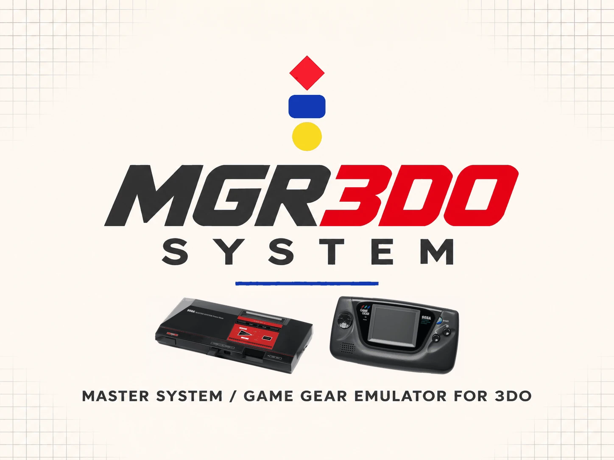
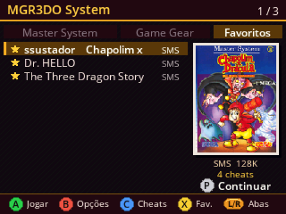
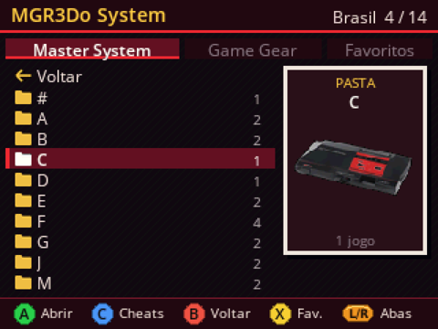
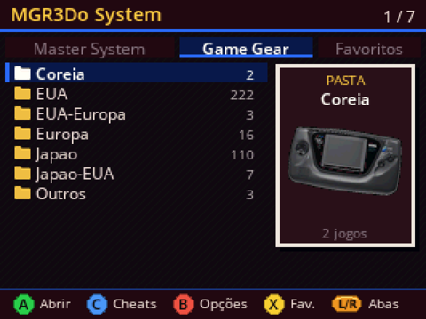
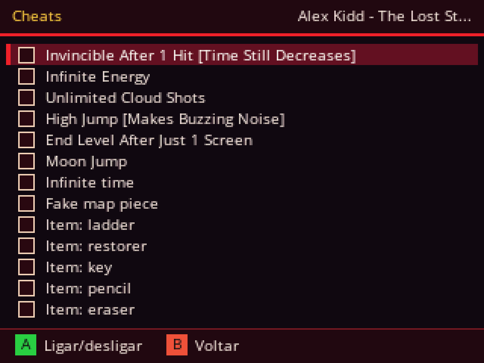
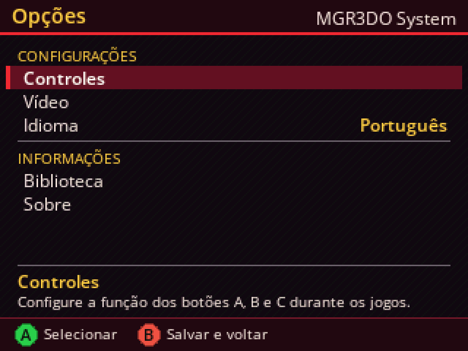
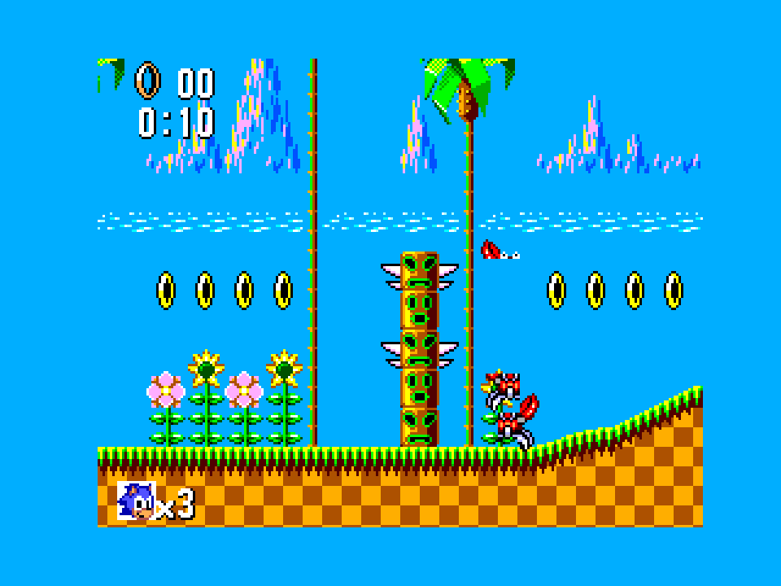
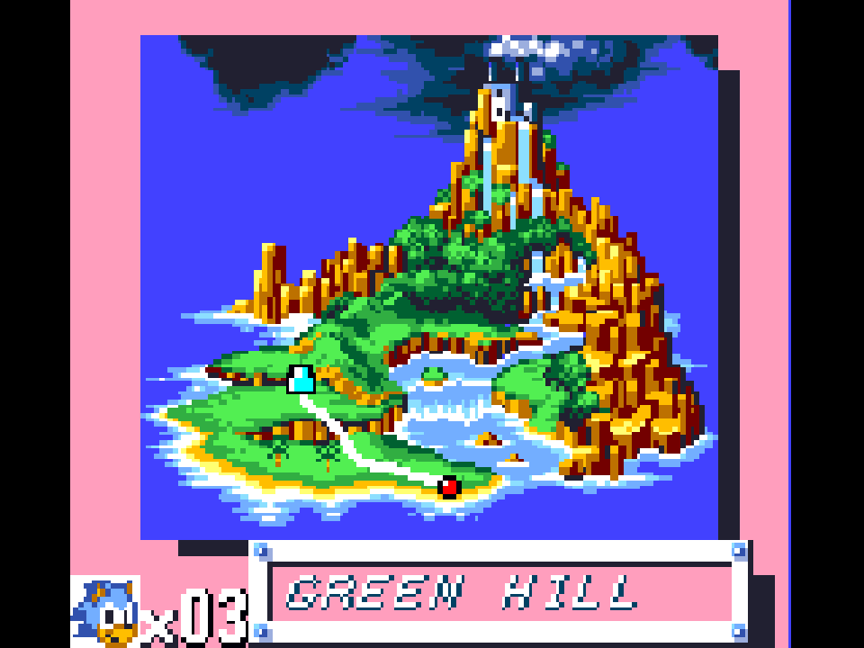
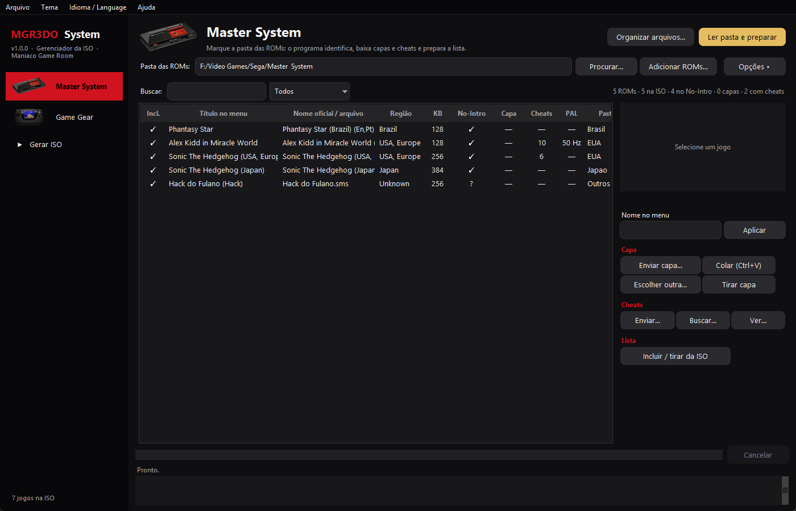
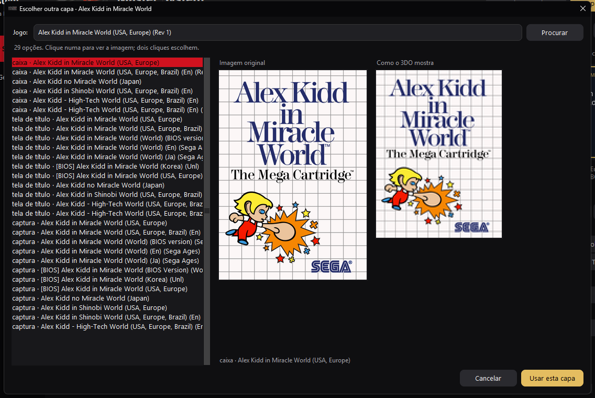

# MGR3DO System

**[English](README.en.md)**

**Emulador de Master System e Game Gear para o 3DO, com menu em português, pastas, capas, cheats prontos e estado salvo no pen drive, e um aplicativo para Windows que monta a ISO a partir das suas ROMs.**

Um projeto **[Maniaco Game Room](https://www.maniacogameroom.com.br/)**.

> **Testado em hardware real:** 3DO com a ODE **SataTo3DO** (firmware ManiacoODE), ISO montada pelo Gerenciador 1.0.0. Veja [O que foi testado](#o-que-foi-testado).

## Novidades da 1.0.0

- **Menu novo:** pastas com ícone, uma cor por aba (Master System vermelho, Game Gear azul, Favoritos âmbar), capa com o console, o tamanho da ROM e quantos **cheats** o jogo tem.
- **P Continuar:** o jogo com estado salvo no pen drive mostra **P Continuar** embaixo da capa; o P abre o jogo direto no ponto salvo.
- **Opções em telas:** Controles (foto do controle do 3DO), Vídeo, Idioma, Biblioteca (quantos jogos, cheats, capas e favoritos) e Sobre.
- **Suavizar zoom:** o Game Gear ampliado (1,25x) pode usar o filtro do próprio 3DO.
- **Gerenciador 1.0.0:** um `.exe` só, que **se atualiza sozinho** pelas Releases; coluna PAL na tabela; escolher outra capa com prévia de como o 3DO mostra.

## O que o MGR3DO System traz

| | |
|---|---|
|  |  |
|  |  |

- **Três abas:** Master System, Game Gear e **Favoritos**, em ordem alfabética, com a **capa** ao lado. Bibliotecas grandes ficam em **pastas** (por região e letra, por exemplo).
- **Favoritos:** o botão **X** marca o jogo com uma estrela; a aba Favoritos junta os dois consoles. Fica guardado na memória do 3DO.
- **Salto por letra:** esquerda e direita pulam para a letra seguinte ou anterior.
- **Cheats prontos** (RAM e Game Genie) para a maior parte dos jogos, ligados e desligados no menu; a escolha fica guardada.
- **Estado salvo no pen drive**, um por jogo, pelo menu do jogo (botão X), e **P Continuar** na lista.
- **Jogos PAL a 50 Hz** com velocidade e música corretas numa TV de 60 Hz.
- **ROMs grandes** (até 4 MB) e **save de bateria** dos jogos que têm (RPGs) na memória do 3DO.
- **Botões configuráveis** (A, B e C), segundo controle, tamanho da tela para TVs que cortam a borda e menu em **português ou English**.

| | |
|---|---|
|  |  |

## O aplicativo: MGR3DO System · Gerenciador

O emulador já vai compilado dentro do aplicativo. Com as suas ROMs no PC, ele:

1. **identifica cada ROM pelo conteúdo** (CRC32 contra o banco No-Intro), lê também `.zip` e escolhe uma boa cópia de cada jogo;
2. **baixa a capa e os cheats** pelo nome oficial;
3. deixa você conferir tudo: enviar a sua capa, **escolher outra** com prévia de como o 3DO a mostra, enviar o seu `.cht`, editar o título, marcar PAL e incluir ou tirar jogos;
4. **monta a ISO** do MGR3DO System, pronta para o pen drive da ODE.

Ele também **organiza a sua pasta** (renomeia pelo nome oficial e separa em pastas, com **Desfazer**) e funciona em **português ou inglês**. As suas ROMs nunca são alteradas.

## Como usar

1. Baixe o **`MGR3Do-System-Gerenciador.exe`** na página de **[Releases](../../releases)** (um arquivo só, sem instalar).
2. Abra o programa, escolha a pasta das ROMs de **Master System** e clique em **Ler pasta e preparar**. Repita na página **Game Gear**.
3. Confira a lista e, em **Gerar ISO**, clique em **Gerar ISO…**.
4. Copie a `MGR3DoSystem.iso` para o pen drive da ODE, escolha a ISO no menu da ODE e jogue.

O aplicativo **se atualiza sozinho**: ao abrir, avisa se há versão nova nas Releases e troca o `.exe` com um clique (Ajuda > Verificar atualizações…).

Passo a passo completo, com os botões do controle: **[Manual](MANUAL.md)**.

## Requisitos

- **3DO** com uma **ODE** que carregue ISO de pen drive ou cartão (testado: SataTo3DO com o firmware ManiacoODE).
- Windows 10 ou 11 para o Gerenciador; internet na primeira vez (capas, cheats e o banco No-Intro ficam guardados no PC).
- As suas ROMs de Master System e Game Gear (`.sms`, `.gg`, soltas ou em `.zip`). **O projeto não traz jogos.**

## Estado salvo: com qual ODE funciona

O estado é gravado num arquivo do pen drive (`MGR3-<jogo>.cap`, na pasta `saves` se houver). Para isso o emulador conversa com a ODE por comandos de arquivo.

| Onde roda | Estado salvo |
|---|---|
| **SataTo3DO com o firmware ManiacoODE** | Funciona: grava no pen drive, fica para a próxima vez e aparece o **P Continuar**. Testado. |
| **SataTo3DO com o firmware original** | Deve funcionar: os comandos de arquivo são os do protocolo da própria ODE. **Não testado.** |
| **Outra ODE** ou **CD gravado** | O jogo roda normalmente, mas o estado fica **só na memória**: dá para carregar enquanto o jogo está aberto e ele se perde ao voltar ao menu ou desligar. A tela avisa: “Estado salvo só na memória”. |

Favoritos, configurações e saves de bateria ficam na memória do próprio 3DO (NVRAM) e não dependem da ODE.

## O que foi testado

- **3DO real** com SataTo3DO / ManiacoODE: menu novo, pastas, capas, cheats, estado salvo com **P Continuar** e Suavizar zoom, com uma ISO montada pelo Gerenciador 1.0.0.
- **Emulador Opera:** os 727 jogos da biblioteca de teste rodados um a um por uma bateria automática (642 sem problema detectado; os demais ficam parados esperando um botão ou com a tela preta).
- **Gerenciador:** 33 testes automáticos e autoteste do `.exe`.

**Limitações conhecidas:** alguns jogos ficam com a tela preta ou com defeito (por exemplo, Cool Spot perde o fundo durante o jogo); só o PSG é emulado (sem o FM do Master System japonês); o zoom do Game Gear é 1,25x.

Master System e Game Gear são marcas da Sega. Projeto independente, sem afiliação à Sega. Não inclui jogos.

## Agradecimento

O MGR3DO System nasceu de uma ideia audaciosa: criar emuladores para o 3DO, e outros projetos estão por vir. Obrigado ao [MasterDO](https://github.com/stanton0arch/MasterDO) por ser um projeto maravilhoso: graças a ele, o nosso pôde evoluir e ter um resultado tão incrível!

---

Um projeto **[Maniaco Game Room](https://www.maniacogameroom.com.br/)**.
